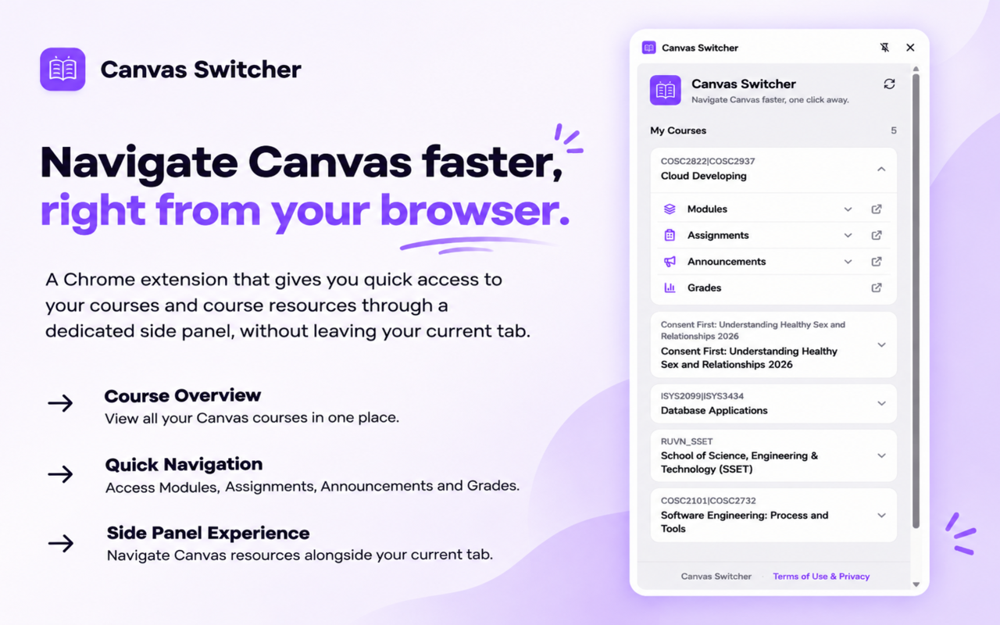

# Canvas Switcher

**Navigate Canvas faster.**

Canvas Switcher is a Chrome extension that brings Canvas course navigation into a dedicated side panel, helping students access their course resources without repeatedly navigating through the Canvas interface.

## Overview

Navigating between course pages, modules, assignments and other resources on Canvas can interrupt a student's workflow. Canvas Switcher provides a more accessible way to navigate course content, allowing students to move between resources while keeping their browsing experience uninterrupted.

## Features

- **Course Overview**: View your available Canvas courses in one place.
- **Quick Navigation**: Quickly access course resources, including Modules, Assignments, Announcements and Grades.
- **Side Panel Experience**: Keep course navigation accessible alongside your current browser tab.
- **Canvas Integration**: Works with supported Canvas sites using your existing Canvas session, without requiring you to enter your Canvas credentials into the extension.

## Privacy

Canvas Switcher accesses course details and related announcements, assignments and modules to provide its navigation features. This information is processed locally within the extension and is not sent to the developer.

See [PRIVACY.md](./PRIVACY.md) for details about data handling and permissions.

## Disclaimer

Canvas Switcher is an independent student-developed project and is not affiliated with, endorsed by, or officially associated with Instructure, Canvas or any educational institution.
